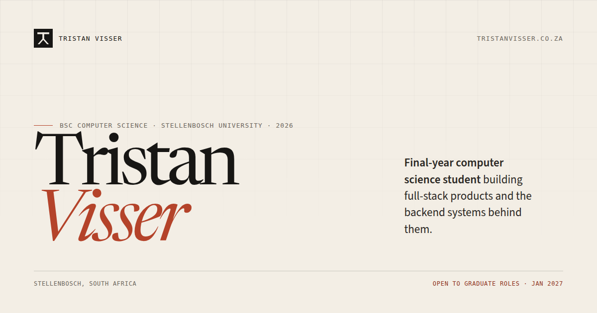

# Tristan Visser · Portfolio

[](https://github.com/tristan-visser/portfolio/actions/workflows/ci.yml)
[](https://tristanvisser.co.za)
[](https://astro.build)
[](https://workers.cloudflare.com)

Personal portfolio and project case studies for **Tristan Visser**, a final-year BSc Computer Science student at Stellenbosch University. The work focuses on full-stack products, backend systems and the decisions behind them.

[Live site](https://tristanvisser.co.za) · [Case studies](https://tristanvisser.co.za/work/) · [CV](https://tristanvisser.co.za/cv/) · [Contact](mailto:hello@tristanvisser.co.za)



## What is in the site

- Seven case studies covering the problem, decisions and trade-offs behind real projects.
- A one-page A4 CV generated from the same content used by `/cv/`.
- Light and warm charcoal dark themes, with system preference as the default and a persisted toggle.
- A contact form protected by Cloudflare Turnstile and delivered through Cloudflare Email Service.
- Canonical metadata, Open Graph images, JSON-LD, sitemap and accessible page structure.
- GitHub Actions for formatting, linting, type checks, unit tests, Playwright/axe and Lighthouse.

## Stack

| Layer      | Choice                                                     |
| ---------- | ---------------------------------------------------------- |
| Framework  | Astro 7 with static output and one on-demand contact route |
| Language   | TypeScript in strict mode                                  |
| Styling    | Tailwind CSS 4 with a custom `@theme` token system         |
| Runtime    | Cloudflare Workers with static assets                      |
| Content    | Astro content collections validated with Zod               |
| Contact    | Cloudflare Turnstile, Email Service and Email Routing      |
| Analytics  | Cloudflare Web Analytics, without cookies                  |
| Testing    | Vitest, Playwright, axe-core and Lighthouse CI             |
| Deployment | GitHub Actions and Wrangler                                |

## Project structure

```text
.
├── public/                  Static assets, security headers and the CV PDF
├── scripts/
│   ├── check-content.mjs    Fails production builds with placeholder content
│   └── generate-cv-pdf.mjs  Prints /cv/print/ to the public CV PDF
├── src/
│   ├── components/          UI, logo, CV sheet and contact form
│   ├── content/projects/    Markdown case studies and their images
│   ├── data/cv.ts           Single source of truth for the CV
│   ├── layouts/             Base layout and print sheet shell
│   ├── lib/                 SEO, projects and contact helpers
│   ├── pages/               Routes, including /api/contact
│   └── styles/              Theme tokens, prose and CV print styles
├── tests/
│   ├── e2e/                 Playwright and axe checks
│   └── unit/                Contact payload tests
├── docs/                    Public design and architecture notes
├── astro.config.mjs
├── lighthouserc.cjs
├── playwright.config.ts
└── wrangler.jsonc
```

## Local development

Requirements:

- Node.js 24 or newer
- pnpm 12 or newer
- `mise` is optional, but `.mise.toml` pins the local toolchain

```sh
mise install        # optional
pnpm install
pnpm cf:types       # generate Cloudflare binding types
pnpm dev
```

The dev server runs at the URL printed by Astro. The contact page accepts both `localhost:4321` and `localhost:4322` in local development.

### Environment

The public Turnstile site key belongs in `.env.local`:

```sh
PUBLIC_TURNSTILE_SITE_KEY=your-site-key
```

The Worker runtime secret and allowed origin belong in `.dev.vars`:

```sh
cp .dev.vars.example .dev.vars
```

`TURNSTILE_SECRET_KEY` is stored as a Cloudflare Worker secret in production. `ALLOWED_ORIGIN` is configured in `wrangler.jsonc` for production and can be overridden locally.

If the site key is missing, the contact page shows a plain email fallback instead of a broken form.

## Commands

| Command              | What it does                                              |
| -------------------- | --------------------------------------------------------- |
| `pnpm dev`           | Start the Astro dev server                                |
| `pnpm check`         | Generate Worker types and run Astro and TypeScript checks |
| `pnpm lint`          | Run ESLint                                                |
| `pnpm format`        | Format the repository with Prettier                       |
| `pnpm format:check`  | Check formatting                                          |
| `pnpm test`          | Run Vitest unit tests                                     |
| `pnpm test:e2e`      | Run Playwright desktop, mobile and dark-mode tests        |
| `pnpm lighthouse`    | Run Lighthouse CI against the local preview               |
| `pnpm build`         | Generate types, validate content and build for production |
| `pnpm build:preview` | Build with placeholder content allowed                    |
| `pnpm preview`       | Preview the production build locally                      |
| `pnpm cv:pdf`        | Regenerate `public/tristan-visser-cv.pdf`                 |
| `pnpm cf:types`      | Regenerate `worker-configuration.d.ts`                    |
| `pnpm deploy`        | Deploy the Worker manually with Wrangler                  |

`worker-configuration.d.ts` is generated and intentionally gitignored. `pnpm check` and `pnpm build` regenerate it automatically.

## Content workflow

Case studies live in `src/content/projects/*.md` and are validated by `src/content.config.ts`. Images live in `src/content/projects/images/`.

A project starts with frontmatter like this:

```yaml
---
title: Example project
summary: A short summary used on the work index and in metadata.
cvSummary: A shorter version used on the CV.
role: Full-stack developer
team: Team of four
timeline: Coursework
year: 2026
stack: [Java, Spring Boot, PostgreSQL]
status: completed
featured: false
order: 4
cover:
  src: ./images/example.png
  alt: A concise description of the screenshot.
  caption: The main view of the project.
---
```

Then write the case study with the problem, what was built, the hard part, key decisions, outcome and what you would do differently. Use `draft: true` to keep a project out of the published collection. `pnpm build` refuses to ship placeholder content.

The CV is edited in `src/data/cv.ts`, not directly in the PDF. To regenerate the PDF:

```sh
pnpm preview --port 4322
pnpm cv:pdf
```

The print route at `/cv/print/` is noindex and uses a light A4 stylesheet. The public PDF is committed so the download is available without a build step.

## Quality and deployment

Push to `main` and GitHub Actions runs the quality job, then deploys the Worker. Pull requests run the same checks without deploying.

The quality job covers:

- formatting, linting and TypeScript checks
- unit tests and Playwright tests across desktop, mobile and dark mode
- axe accessibility checks on every public page
- Lighthouse CI with performance, accessibility, best-practices and SEO gates

The production site is served from the apex domain `tristanvisser.co.za`. `www` redirects to the apex, HTTP redirects to HTTPS and HSTS is enabled at the Cloudflare zone. The contact form is restricted to the production origin.

Deployment secrets are stored in GitHub Actions and Cloudflare. They are never committed:

- `CLOUDFLARE_API_TOKEN` and `CLOUDFLARE_ACCOUNT_ID` in GitHub Actions
- `TURNSTILE_SECRET_KEY` as a Worker secret
- `PUBLIC_TURNSTILE_SITE_KEY` in the build environment
- `CONTACT_TO`, `CONTACT_FROM` and `ALLOWED_ORIGIN` in `wrangler.jsonc`

## Documentation

- [Design system](docs/design.md)
- [Architecture decisions](docs/decisions.md)
- [OG image source](docs/design/og.html)

## Usage and rights

This is a personal portfolio, not a template. The source is public for review and reference. The written case studies, CV, project screenshots, personal images and brand assets are © Tristan Visser and may not be reused without permission.

## Contact

- Site: [tristanvisser.co.za](https://tristanvisser.co.za)
- Email: [hello@tristanvisser.co.za](mailto:hello@tristanvisser.co.za)
- LinkedIn: [linkedin.com/in/tristan-visser](https://www.linkedin.com/in/tristan-visser/)
- GitHub: [github.com/tristan-visser](https://github.com/tristan-visser)
